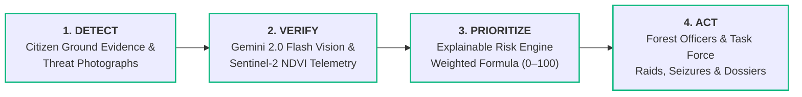
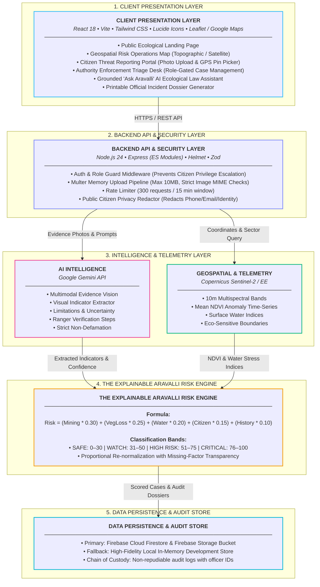

# 🌿 ARAVALLI SENTINEL

> **See the Threat. Predict the Risk. Protect the Aravallis.**  
> *An AI-Powered Ecological Early-Warning and Action Platform for the Aravalli Ecosystem.*

[](LICENSE)
[]()
[]()
[]()
[]()

---

## 🎯 Project Overview & Vision

The **Aravalli Mountain Range** spans over 690 km across Gujarat, Rajasthan, Haryana, and Delhi NCR. It is India’s most ancient geological formation and the primary barrier preventing the eastward expansion of the Thar Desert into northern India's fertile agrarian plains and the National Capital Region.

Despite repeated bans by the **Supreme Court of India** (*M.C. Mehta vs Union of India*), the Aravalli range faces relentless threats from unauthorized open-pit quarrying, commercial deforestation of native *Anogeissus pendula* (Dhau) woodlands, unpermitted construction, and toxic leachate contamination.

**ARAVALLI SENTINEL** bridges grassroots citizen vigilance with satellite remote sensing and Google Gemini AI to equip Forest Departments and District Task Forces with defensible, explainable intelligence.

---

## 🔄 Core Operational Workflow



<details>
<summary>View ASCII Workflow Diagram</summary>

```
   ┌──────────┐         ┌──────────┐         ┌──────────────┐         ┌──────────┐
   │  DETECT  │   ──►   │  VERIFY  │   ──►   │  PRIORITIZE  │   ──►   │   ACT    │
   └──────────┘         └──────────┘         └──────────────┘         └──────────┘
 Citizen Ground       Gemini 2.0 Flash        Explainable Risk       Forest Officers &
 GPS Evidence &      Multimodal Vision &      Engine (0 to 100)       Mining Task Force
 Threat Photographs   Sentinel-2 NDVI          Weighted Formula       Raids & Seizures
```
</details>

1. **DETECT:** Authenticated citizens and eco-sentinels capture geotagged field photos of suspected excavation, illegal tree felling, or dumping.
2. **VERIFY:** Server-side Google Gemini AI extracts objective visual indicators and limitations, while remote sensing providers cross-reference regional canopy anomalies.
3. **PRIORITIZE:** The deterministic **Explainable Risk Engine** scores the sector from 0 to 100 across 5 weighted vectors, identifying primary risk drivers.
4. **ACT:** Authorized Forest Officers review cases in the triage portal, update statuses (`under_review`, `verified`, `resolved`), log audit entries, and generate printable incident dossiers.

---

## 🏛️ High-Level System Topology

> For the comprehensive architectural and legal specification, see [`docs/ARCHITECTURE.md`](docs/ARCHITECTURE.md).



---

## 📐 The Explainable Aravalli Risk Engine

The platform implements a transparent, weighted formula across 5 critical environmental vectors:

$$\text{Overall Risk} = (M \times 0.30) + (V \times 0.25) + (W \times 0.20) + (C \times 0.15) + (H \times 0.10)$$

| Factor | Weight | Description |
| :--- | :---: | :--- |
| **$M$ (Mining Risk)** | **30%** | Proximity to illegal quarrying cuts, blasting signatures, and heavy dumper haul tracks. |
| **$V$ (Vegetation Loss)** | **25%** | Sentinel-2 NDVI degradation index and native Dhau canopy fragmentation. |
| **$W$ (Water Stress)** | **20%** | Groundwater table drawdown, check-dam breach, and seasonal nallah blockages. |
| **$C$ (Citizen Evidence)** | **15%** | Density, frequency, and corroboration of citizen reports submitted within 30 days. |
| **$H$ (Historical Trend)** | **10%** | Decadal transition trend from protected deemed forest to denuded rocky scrub. |

### Classification Bands:
- 🟢 **SAFE ($0 - 30$):** Baseline ecological equilibrium. Routine monitoring.
- 🟡 **WATCH ($31 - 50$):** Early warning signals. Scheduled drone or ranger patrol recommended.
- 🟠 **HIGH RISK ($51 - 75$):** Severe ecological distress. Immediate on-site inspection warranted.
- 🔴 **CRITICAL ($76 - 100$):** Imminent destruction. Inter-departmental enforcement mobilized under Supreme Court ban.

---

## 📁 Repository Structure

```
ARAVALLI SENTINEL/
├── backend/
│   ├── src/
│   │   ├── config/              # Environment, Firebase Admin, Gemini SDK
│   │   ├── controllers/         # Reports, Zones, AI, Auth controllers
│   │   ├── data/                # Aravalli zones dataset, seed reports
│   │   ├── middleware/          # Auth, role guard, Multer upload, rate limiting
│   │   ├── routes/              # Express API endpoints
│   │   ├── services/            # Risk Engine, Gemini AI, Geospatial Provider
│   │   ├── validators/          # Zod validation schemas
│   │   └── server.js            # Express application entry point
│   ├── tests/                   # Vitest unit tests (Risk Engine) & Supertest API tests
│   ├── .env.example             # Backend environment documentation
│   └── package.json
├── frontend/
│   ├── src/
│   │   ├── components/          # MapView, RiskBadge, AIAnalysisCard, Navbar, Footer, Dossier
│   │   ├── context/             # AuthContext (session persistence & persona switcher)
│   │   ├── pages/               # Landing, RiskMap, ReportThreat, Authority, AskAravalli
│   │   ├── services/            # API client
│   │   ├── App.jsx              # Routing & Layout
│   │   └── main.jsx             # React entry point
│   ├── .env.example             # Frontend environment documentation
│   ├── vite.config.js
│   ├── tailwind.config.js
│   └── package.json
├── docs/
│   ├── ARCHITECTURE.md          # In-depth architectural design
│   ├── API_SPEC.md              # REST API documentation
│   ├── FIREBASE_SETUP.md        # Firestore & Storage production guide
│   ├── DEPLOYMENT.md            # Cloud Run / Firebase deployment
│   └── DEMO_WALKTHROUGH.md      # Step-by-step evaluator demo script
├── firestore.rules              # Least-privilege Firestore rules
├── storage.rules                # 10MB image limit Storage rules
├── package.json                 # Monorepo orchestration scripts
└── README.md
```

---

## ⚡ Quickstart Guide (Windows PowerShell)

### 1. Install Dependencies
```powershell
# From root directory:
npm run install:all
```

### 2. Configure Environment Variables
Copy `.env.example` templates to `.env`:
```powershell
cp backend/.env.example backend/.env
cp frontend/.env.example frontend/.env
```
*(Default settings run in **High-Fidelity Demonstration Mode** immediately with zero credentials required! To enable live Gemini AI, paste your API key in `backend/.env`.)*

### 3. Run Unit & Integration Tests
```powershell
npm run test:backend
```
*(All 15 tests in 2 test suites will execute and verify risk engine formulas, boundary validation, and API role guards.)*

### 4. Start the Application
Open two PowerShell terminals:

**Terminal 1 (Backend API):**
```powershell
npm run dev:backend
```
*Backend active at: `http://localhost:5000` (Health Check: `http://localhost:5000/api/health`)*

**Terminal 2 (Frontend Interface):**
```powershell
npm run dev:frontend
```
*Frontend active at: `http://localhost:5173`*

---

## 🛡️ Security & Role Enforcement

- **No Privilege Escalation:** Public registration is hardcoded to the `citizen` role. Citizens cannot escalate to `authority`.
- **Server-Side Protection:** `requireAuthority` middleware verifies tokens and rejects unauthorized requests with `403 Forbidden`.
- **Authority Provisioning:** Official accounts require the server-side `AUTHORITY_INVITE_SECRET` or admin claim.
- **Citizen Privacy:** Citizen phone numbers, email addresses, and identities are completely redacted from public APIs.
- **Upload Hardening:** Multer restricts uploads to JPEG, PNG, WEBP, and HEIC files with a strict 10MB ceiling.
- **Audit Immutability:** Case status transitions require mandatory action notes and store the acting authority's identity in the audit trail.

---

## 🧪 Verification Commands & Test Results

```
Test Files  2 passed (2)
     Tests  33 passed (33)
  Duration  2.15s
```
- `tests/riskEngine.test.js` (11 unit tests): Validates weights sum to 1.00, exact formula precision, boundary validation (0–100), classification bands, proportional multi-vector re-weighting, edge case boundary handling (0 equilibrium & 100 maximum risk), all-missing factor error handling, and dynamic primary driver detection.
- `tests/api.test.js` (22 integration tests): Validates system health check, 4-state zone filtering (including Gujarat), zone telemetry details, dynamic risk recalculation, threat report category filtering (toxic dumping, groundwater depletion, etc.), rejected status audits, single report lookup and 404s, printable incident dossiers, citizen privacy redaction, Ask Aravalli grounded responses, standalone AI evidence vision analysis, and role-gated status transitions with Zod validation.

---

## 📜 Regulatory Citations & Legal Safeguards
- **Supreme Court of India:** *M.C. Mehta vs Union of India* (2002, 2004, 2009) — Prohibiting mining activities across notified Aravalli hill ranges.
- **Punjab Land Preservation Act (PLPA) 1900 (Sec 4 & 5):** Restricting non-forestry tree cutting and construction on hill tracts.
- **Environment (Protection) Act, 1986 & Forest Conservation Act, 1980:** Statutory basis for eco-sensitive zone protections.

*Disclaimer: AI inferences generated by Google Gemini are decision-support assessments and do not constitute official judicial determinations or legal findings. Field verification by authorized government personnel is mandatory.*
