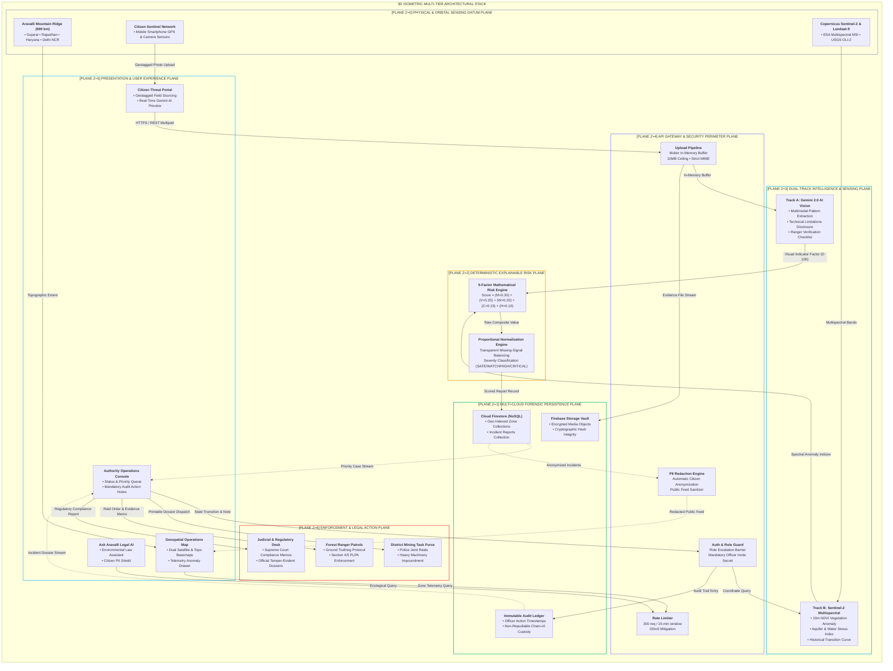
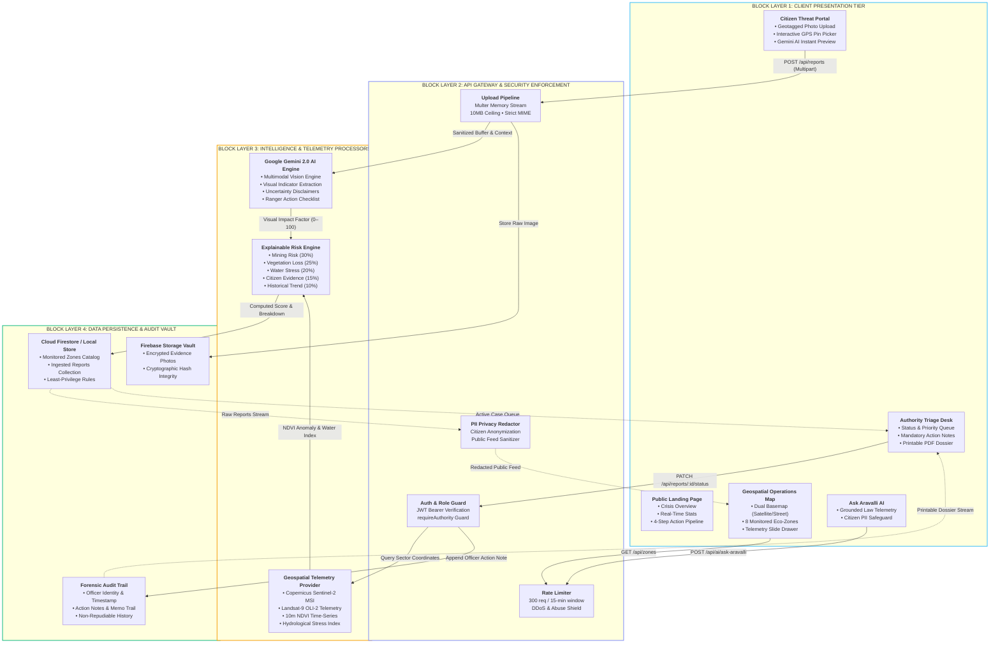
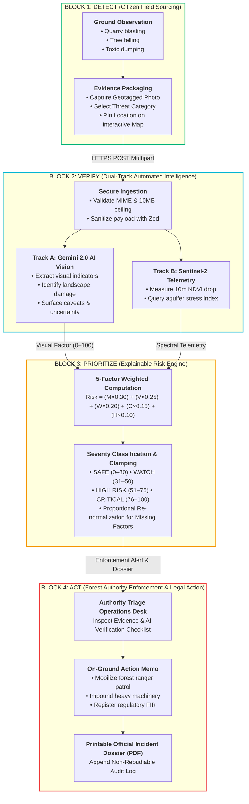
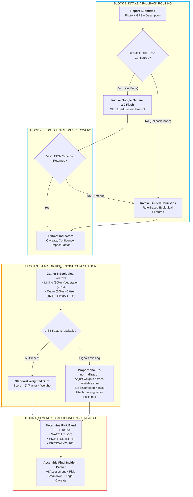
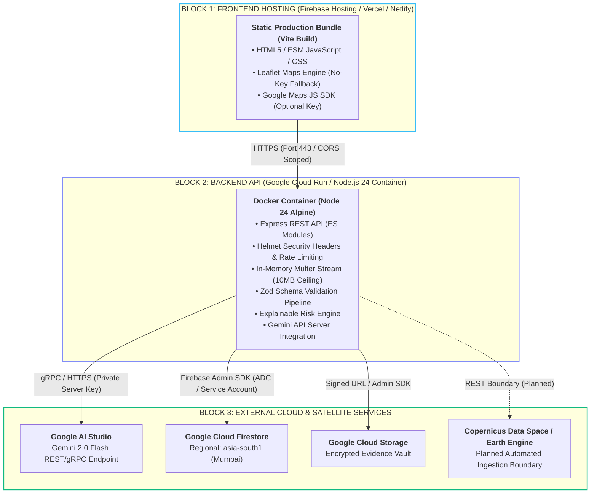

# ARAVALLI SENTINEL — Technical Design Document

> **System Name:** ARAVALLI SENTINEL  
> **Tagline:** *See the Threat. Predict the Risk. Protect the Aravallis.*  
> **Document Version:** 1.0.0 (Production Architecture & Hackathon Specification)  
> **Target Biome:** The Aravalli Mountain Range (Gujarat, Rajasthan, Haryana, Delhi NCR)  
> **Primary Jurisprudence:** Supreme Court of India (*M.C. Mehta vs. Union of India*, 2002/2004/2009), Punjab Land Preservation Act (PLPA 1900, Sec 4/5), Environment (Protection) Act 1986.

---

## A. System Overview

### 1. Purpose & Scope
**Aravalli Sentinel** is an AI-assisted ecological early-warning and rapid enforcement prioritization platform. It is engineered to protect the 690-kilometer Aravalli mountain belt—northwest India's primary ecological shield against the eastern expansion of the Thar Desert and the vital groundwater recharge aquifer for Delhi NCR and surrounding states.

The platform bridges grassroots citizen observations with satellite remote sensing telemetry and Google Gemini AI multimodal vision. It provides authorized environmental officers (Divisional Forest Officers, State Pollution Control Boards, Mining Task Forces) with defensible, explainable intelligence to accelerate on-site inspections while strictly prohibiting premature or unverified legal determinations.

### 2. Problem Being Addressed
1. **Illegal Mining & Quarrying:** Mechanical stone excavation, illegal hill blasting, and ridge flattening occurring outside or in direct violation of Supreme Court mining bans.
2. **Deforestation & Canopy Loss:** Systematic felling of slow-growing, native climax *Anogeissus pendula* (Dhau) woodlands for timber and speculative real estate encroachment.
3. **Hydrological & Aquifer Drawdown:** Blockage of natural seasonal streams (*nallahs*) from overburden dumping, check-dam destruction, and unpermitted commercial borewell clusters.
4. **Toxic Leachate & Debris Dumping:** Industrial and municipal waste tipping into abandoned open quarry pits, contaminating subterranean groundwater tables.
5. **Enforcement Latency & Black-Box Secrecy:** Citizen complaints often languish in administrative queues, while enforcement teams lack calibrated risk prioritization tools to allocate limited ranger patrol units.

### 3. Functional Requirements
- **FR-01 (Public Sighting & Geotagged Ingestion):** Citizens can submit photographic evidence, GPS coordinates, location names, and threat categories.
- **FR-02 (Citizen Privacy Shield):** Citizen identities (names, phone numbers, emails, UIDs) are completely redacted from public-facing endpoints and feeds.
- **FR-03 (Automated Multimodal Evidence Assessment):** Server-side Google Gemini 2.0 Flash engine parses field images, identifies visual landscape indicators, surfaces technical caveats, and generates ranger ground-verification checklists.
- **FR-04 (Explainable Risk Scoring):** The Explainable Risk Engine calculates an index from 0 to 100 based on 5 weighted inputs ($30\% / 25\% / 20\% / 15\% / 10\%$) with transparent re-normalization for missing factors.
- **FR-05 (Geospatial Operations Map):** Interactive dual-basemap (high-resolution satellite imagery + topographic map) displaying monitored sectors, colored risk buffers, and telemetry side drawers.
- **FR-06 (Authority Triage Operations Desk):** Verified enforcement officers can filter, search, inspect, and update case statuses (`pending`, `under_review`, `verified`, `resolved`, `rejected`) with mandatory action audit logs.
- **FR-07 (Printable Official Incident Dossier):** Automated generation of printable, tamper-evident case briefing dossiers with evidence thumbnails, AI observations, risk breakdowns, and officer signature blocks.
- **FR-08 (Grounded Ask Aravalli Assistant):** A conversational AI assistant answering ecological, geospatial, and regulatory legal questions grounded in live platform data.

### 4. Non-Functional Requirements
- **NFR-01 (Zero-Credential Resilience):** The platform features a high-fidelity local fallback mode for Firebase and Gemini, allowing immediate local development, testing, and evaluation without requiring live credentials.
- **NFR-02 (Zero Client-Side Secret Leakage):** Gemini API keys and Firebase Admin private keys are strictly confined to the backend server and never sent to frontend bundles.
- **NFR-03 (Security & Least Privilege):** Strict input sanitization via Zod, rate limiting (300 req/15 min), role escalation prevention, and least-privilege security rules for Firestore and Storage.
- **NFR-04 (Performance & Latency):** Sub-second API response times for cached zone telemetry and under 3 seconds for multimodal AI evidence analysis.
- **NFR-05 (Auditability & Non-Repudiation):** Status changes cannot be executed without recording the acting officer's identity, timestamp, and action notes in an immutable audit log.

### 5. Assumptions & Constraints
- **Legal Non-Defamation Constraint:** AI vision inferences and risk scores are decision-support estimates. They do not constitute judicial evidence or proof of legal guilt. Field verification by authorized government personnel is mandatory under Indian environmental laws.
- **Connectivity:** Citizen devices require intermittent GPS and internet connectivity; offline field captures can be queued and uploaded upon reconnection.

---

## B. System Architecture

### 3D Isometric Multi-Tier Architecture (Spatial Block Model)

The ARAVALLI SENTINEL system is conceptualized as a **multi-dimensional, multi-tiered stacked architecture**. The system spans vertically from physical ground sensors in the Aravalli hills and satellite orbits up to judicial review boards and field enforcement patrols.



<details>
<summary>View 3D Isometric ASCII Spatial Topology</summary>

```
                                  ▲ +Z (Authority Enforcement & Judicial Action)
                                 │
                     ┌───────────────────────────────────────────────┐
                    ╱   PLANE Z=6: ENFORCEMENT & LEGAL ACTION       ╱│
                   ┌───────────────────────────────────────────────┐ │
                   │ • Forest Rangers • Mining Task Force • NGT    │ │
                   │ • FIR Memos      • Machinery Seizure Orders   │ │
                   └───────────────────────────────────────────────┘ │
                     ▲                                             ▲ │
                     │  Printable Official Dossiers & Raid Orders  │ ┼
                     │                                             │╱
                     ┌───────────────────────────────────────────────┐
                    ╱   PLANE Z=5: CLIENT PRESENTATION & UI         ╱│
                   ┌───────────────────────────────────────────────┐ │
                   │ • Citizen Threat Portal • Geospatial Risk Map │ │
                   │ • Authority Triage Desk • Ask Aravalli AI     │ │
                   └───────────────────────────────────────────────┘ │
                     ▲                                             ▲ │
                     │  HTTPS / REST / JWT Bearer Tokens           │ ┼
                     │                                             │╱
                     ┌───────────────────────────────────────────────┐
                    ╱   PLANE Z=4: API GATEWAY & SECURITY DEFENSE   ╱│
                   ┌───────────────────────────────────────────────┐ │
                   │ • Rate Limiter (300 req/15m) • PII Redactor   │ │
                   │ • Multer In-Memory Stream    • Anti-Escalation│ │
                   └───────────────────────────────────────────────┘ │
                     ▲                                             ▲ │
                     │  Sanitized Buffers & Coordinate Sectors     │ ┼
                     │                                             │╱
                     ┌───────────────────────────────────────────────┐
                    ╱   PLANE Z=3: DUAL-TRACK INTELLIGENCE & SENSING╱│
                   ┌───────────────────────────────────────────────┐ │
                   │ • Google Gemini 2.0 Flash Multimodal Vision   │ │
                   │ • Copernicus Sentinel-2 MSI 10m NDVI Engine   │ │
                   └───────────────────────────────────────────────┘ │
                     ▲                                             ▲ │
                     │  Visual Threat Factor & Spectral Anomaly    │ ┼
                     │                                             │╱
                     ┌───────────────────────────────────────────────┐
                    ╱   PLANE Z=2: EXPLAINABLE ARAVALLI RISK ENGINE ╱│
                   ┌───────────────────────────────────────────────┐ │
                   │ • 5-Factor Deterministic Index (M,V,W,C,H)   │ │
                   │ • Proportional Normalization for Missing Data │ │
                   └───────────────────────────────────────────────┘ │
                     ▲                                             ▲ │
                     │  Composite Score (0-100) & Contributing Drivers
                     │                                             │╱
                     ┌───────────────────────────────────────────────┐
                    ╱   PLANE Z=1: MULTI-CLOUD FORENSIC PERSISTENCE ╱│
                   ┌───────────────────────────────────────────────┐ │
                   │ • Cloud Firestore NoSQL  • Storage Vault      │ │
                   │ • Immutable Audit Ledger • High-Fidelity Local│ │
                   └───────────────────────────────────────────────┘ │
                     ▲                                             ▲ │
                     │  Ground Photographic Evidence & Satellite Passes
                     │                                             │╱
                     ┌───────────────────────────────────────────────┐
                    ╱   PLANE Z=0: PHYSICAL & ORBITAL DATUM PLANE   ╱│
                   ┌───────────────────────────────────────────────┐ │
                   │ • 690 km Aravalli Ridge (GJ, RJ, HR, DL)      │ │
                   │ • Sentinel-2A/B Constellation • Citizen Phones│ │
                   └───────────────────────────────────────────────┘ │
                     │                                             │╱
                     └─────────────────────────────────────────────┘
                    +X (Process Pipeline) ────────►  +Y (Data Depth)
```
</details>

---

### Diagram 1: High-Level System Architecture (Block Flowchart)



---

### Diagram 2: End-to-End Threat Reporting Workflow (`DETECT → VERIFY → PRIORITIZE → ACT`) Block Flowchart



---

### Diagram 3: Component Data Flow Block Flowchart

```mermaid
flowchart LR
    subgraph INGRESS_BLOCK["INGRESS BLOCK"]
        CITIZEN["<b>Citizen Sentinel</b>"]
        INGEST["<b>Ingestion API</b><br/>POST /api/reports"]
        AUTH_GUARD["<b>Auth Guard</b><br/>Role Validation"]
    end

    subgraph PROCESSING_BLOCK["ANALYTICS & RISK BLOCK"]
        GEMINI_SRV["<b>Gemini 2.0 Service</b><br/>Visual Indicator AI"]
        GEO_SRV["<b>Geospatial Provider</b><br/>NDVI & Water Indices"]
        RISK_ENG["<b>Risk Engine</b><br/>5-Factor Weighted Model"]
    end

    subgraph PERSISTENCE_BLOCK["DATA VAULT BLOCK"]
        DB[("<b>Firestore / Store</b><br/>Zone & Incident Records")]
        STORAGE[("<b>Storage Vault</b><br/>Evidence Photos")]
        AUDIT_WRITER["<b>Audit Logger</b><br/>Non-Repudiable Log")]
    end

    subgraph EGRESS_BLOCK["EGRESS & TRIAGE BLOCK"]
        AUTH_DESK["<b>Authority Console</b><br/>Triage & PDF Dossiers"]
        MAP_VIEW["<b>Public Risk Map</b><br/>Redacted Safe Feed"]
    end

    CITIZEN -->|"1. Image, GPS, Description"| INGEST
    INGEST -->|"2. Verify Token & Role"| AUTH_GUARD
    AUTH_GUARD -->|"3. Binary Image Buffer"| GEMINI_SRV
    AUTH_GUARD -->|"4. Sector Coordinates"| GEO_SRV
    
    GEMINI_SRV -->|"5. AI Visual Factor (0-100)"| RISK_ENG
    GEO_SRV -->|"6. NDVI & Water Telemetry"| RISK_ENG
    
    RISK_ENG -->|"7. Weighted Composite Score"| DB
    INGEST -->|"8. Raw Evidence Image"| STORAGE
    
    DB -->|"9. Query Reports (Unredacted)"| AUTH_DESK
    DB -->|"10. Public Query (Redacted)"| MAP_VIEW
    
    AUTH_DESK -->|"11. Update Status & Notes"| AUDIT_WRITER
    AUDIT_WRITER -->|"12. Append Log Entry"| DB

    classDef ing stroke:#38bdf8,stroke-width:2px;
    classDef prc stroke:#f59e0b,stroke-width:2px;
    classDef per stroke:#10b981,stroke-width:2px;
    classDef egr stroke:#818cf8,stroke-width:2px;

    INGRESS_BLOCK:::ing
    PROCESSING_BLOCK:::prc
    PERSISTENCE_BLOCK:::per
    EGRESS_BLOCK:::egr
```

---

### Diagram 4: AI-Assisted Evidence Analysis & Risk-Scoring Block Flowchart



---

### Diagram 5: Cloud Deployment Architecture (Block Flowchart)



---

## C. Technology Stack

| Technology | Purpose in System | Implementation Location | Implementation Status |
| :--- | :--- | :--- | :---: |
| **Node.js (v24)** | Server-side runtime environment | `backend/src/` | **Implemented** |
| **Express.js (v4.21)** | REST API framework, routing, error handling | `backend/src/server.js` | **Implemented** |
| **Zod (v3.24)** | Strong schema validation for inputs and coordinates | `backend/src/validators/` | **Implemented** |
| **Multer (v1.4)** | Multipart memory streaming and MIME/size validation | `backend/src/middleware/upload.js` | **Implemented** |
| **Helmet (v8.0)** | Security HTTP response headers and CSP policies | `backend/src/server.js` | **Implemented** |
| **Express Rate Limit** | Protection against API spam and DDoS | `backend/src/server.js` | **Implemented** |
| **Google Generative AI SDK**| Multimodal evidence analysis & Ask Aravalli chat | `backend/src/services/geminiService.js` | **Implemented** |
| **Firebase Admin SDK** | Server-side authentication verification and storage | `backend/src/config/firebase.js` | **Implemented** |
| **React (v18.3)** | Component-based interactive UI | `frontend/src/` | **Implemented** |
| **Vite (v6.2)** | Build tool and fast HMR development server | `frontend/vite.config.js` | **Implemented** |
| **Tailwind CSS (v3.4)** | Ecological design system and responsive styling | `frontend/src/index.css` | **Implemented** |
| **Leaflet (v1.9)** | Interactive satellite & street tile map engine | `frontend/src/components/MapView.jsx` | **Implemented** |
| **Google Maps JS API** | Alternative commercial map provider | `frontend/src/components/MapView.jsx` | **Implemented (Dual-Mode)** |
| **Vitest (v3.2)** | Unit and integration test runner | `backend/tests/` | **Implemented** |
| **Supertest (v7.0)** | HTTP integration test harness | `backend/tests/api.test.js` | **Implemented** |
| **Google Earth Engine (GEE)**| Live satellite multispectral analysis integration | `backend/src/services/geospatialProvider.js` | *Boundary Implemented; Live Ingestion Planned* |
| **Push Notifications (FCM)** | Automated alert dispatch to rangers | `frontend/src/` | *Planned* |

---

## D. Core Modules & Responsibilities

### 1. Backend Ingestion & Routing (`backend/src/routes/`, `controllers/`)
- **`reportsController.js`:** Handles report creation, image processing, calls Gemini and Risk Engine, stores report records, redacts citizen identities for public endpoints, and compiles legal dossiers.
- **`zonesController.js`:** Serves the catalog of monitored Aravalli sectors, calculates live telemetry anomalies, and powers the interactive risk recalculator.
- **`aiController.js`:** Provides isolated pre-submission evidence analysis preview and manages conversational context for the Ask Aravalli assistant.
- **`authController.js`:** Enforces non-escalating citizen registration, verifies official invite tokens for authority accounts, and manages demo persona sessions.

### 2. Explainable Risk Engine (`backend/src/services/riskEngine.js`)
- **Responsibility:** Implements the deterministic 5-factor scoring model.
- **Inputs:** `factors: { miningRisk, vegetationLoss, waterStress, citizenEvidence, historicalChange }`.
- **Outputs:** Comprehensive calculation packet with composite score (0–100), severity band, contributing factor breakdown, primary driver name, and transparency metadata.

### 3. Gemini Multimodal Service (`backend/src/services/geminiService.js`)
- **Responsibility:** Multimodal image inspection and contextual grounding.
- **Inputs:** Binary image buffer, MIME type, threat category, user description, field coordinates.
- **Outputs:** Structured JSON containing visual indicators, threat category assessment, scientific explanation, limitations/uncertainty callout, confidence level, and ranger ground verification checklist.

### 4. Geospatial Telemetry Provider (`backend/src/services/geospatialProvider.js`)
- **Responsibility:** Abstract boundary interface for remote sensing telemetry.
- **Implementations:**
  - `SentinelHubSimulatorProvider`: Deterministic baseline simulator reflecting published ISRO Bhuvan and Copernicus spectral values.
  - `EarthEngineLiveProvider`: Integration boundary awaiting active Google Cloud service account keys.

---

## E. The Explainable Aravalli Risk Engine

The platform strictly avoids opaque machine-learning risk scores in favor of a **deterministic, transparent, multi-vector formulation** suitable for administrative review:

### Formula
$$\text{Overall Risk} = (M \times 0.30) + (V \times 0.25) + (W \times 0.20) + (C \times 0.15) + (H \times 0.10)$$

### Verified Factor Weights in Codebase:
- **$M$ (Mining Risk, 30%):** Verified in [`backend/src/services/riskEngine.js`](file:///c:/Users/dlakh/Desktop/ARAVALLI%20SENTINEL/backend/src/services/riskEngine.js) as `WEIGHTS.miningRisk = 0.30`.
- **$V$ (Vegetation Loss, 25%):** Verified as `WEIGHTS.vegetationLoss = 0.25`.
- **$W$ (Water Stress, 20%):** Verified as `WEIGHTS.waterStress = 0.20`.
- **$C$ (Citizen Evidence, 15%):** Verified as `WEIGHTS.citizenEvidence = 0.15`.
- **$H$ (Historical Change, 10%):** Verified as `WEIGHTS.historicalChange = 0.10`.

$$\sum_{i=1}^5 W_i = 0.30 + 0.25 + 0.20 + 0.15 + 0.10 = 1.00$$

### Severity Classification Thresholds:
| Score Band | Severity Level | Color Code | Administrative Protocol |
| :---: | :---: | :---: | :--- |
| **0 – 30** | **SAFE** | 🟢 Emerald (`#10b981`) | Ecological baseline. Routine satellite pass monitoring. |
| **31 – 50** | **WATCH** | 🟡 Amber (`#f59e0b`) | Early warning. Schedule drone reconnaissance and joint forest ranger patrol within 7 days. |
| **51 – 75** | **HIGH RISK** | 🟠 Orange (`#f97316`) | Elevated threat. Issue formal show-cause inspection notice, mobilize field task force, and alert District Magistrate. |
| **76 – 100**| **CRITICAL** | 🔴 Red (`#ef4444`) | Imminent destruction. Immediate enforcement raid required under Supreme Court ban; machinery seizure and FIR registration. |

### Transparent Missing-Data Handling:
If one or more vectors are unavailable (e.g. cloud cover obscuring optical NDVI):
1. The engine calculates the sum of available weights $\Omega = \sum_{k \in \text{available}} W_k$.
2. It proportionally re-weights the available factors: $W'_k = \frac{W_k}{\Omega}$.
3. It flags `transparency.isComplete = false`.
4. It appends an explicit limitation notice:  
   *`"Score recalculated across 80% available weight. Missing: waterStress."`*

---

## F. API Design & Endpoint Reference

Base Endpoint: `http://localhost:5050/api`

| Endpoint | Method | Auth Required | Description | Request Body | Response Format |
| :--- | :---: | :---: | :--- | :--- | :--- |
| `/health` | `GET` | No | System health diagnostics | None | `{ status, platform, services: {...} }` |
| `/zones` | `GET` | No | List monitored Aravalli sectors | Query params (`state`, `riskLevel`) | `{ success: true, count, zones: [...] }` |
| `/zones/:id`| `GET` | No | Specific zone telemetry & NDVI | URL param `id` | `{ success: true, zone, timeSeries }` |
| `/zones/recalculate-risk` | `POST` | No | Recalculate score dynamically | `{ factors: {...} }` | `{ success: true, score, riskLevel, contributions }` |
| `/reports` | `GET` | Optional | List reports (redacts PII for public) | Query params (`status`, `threatCategory`) | `{ success: true, count, reports: [...] }` |
| `/reports` | `POST` | Optional | Submit citizen threat report | `multipart/form-data` (photo, coords, category) | `{ success: true, report: {...} }` (201 Created) |
| `/reports/:id` | `GET` | Optional | Retrieve single report | URL param `id` | `{ success: true, report: {...} }` |
| `/reports/:id/status` | `PATCH` | **Authority Only** | Update case status & action notes | `{ status, actionNotes, assignedOfficer }` | `{ success: true, message, report: {...} }` |
| `/reports/:id/incident-dossier` | `GET` | Optional | Generate printable legal dossier | URL param `id` | `{ success: true, dossier: {...} }` |
| `/ai/analyze-evidence` | `POST` | No | Preview evidence without saving | `multipart/form-data` (image, threatCategory) | `{ success: true, analysis: {...} }` |
| `/ai/ask-aravalli` | `POST` | Optional | Grounded legal & telemetry query | `{ question: string }` | `{ success: true, answer, source }` |
| `/auth/login-demo` | `POST` | No | Switch demo persona | `{ role: 'citizen' \| 'authority' }` | `{ success: true, user, token }` |
| `/auth/register-citizen` | `POST` | No | Register public citizen account | `{ email, fullName, password }` | `{ success: true, user, token }` (201 Created) |
| `/auth/register-authority` | `POST` | No | Provision authority with secret | `{ email, fullName, department, inviteSecret }` | `{ success: true, user, token }` (201 Created) |
| `/auth/profile` | `GET` | **Bearer Token** | Retrieve active session profile | Authorization: `Bearer <token>` | `{ success: true, user: {...} }` |

---

## G. Data Model

### Primary Firestore Collections

#### 1. `reports` Collection
```json
{
  "id": "rep-aravalli-2026-001",
  "threatCategory": "Illegal Mining & Quarrying",
  "description": "Continuous night-time blasting and heavy JCB movements...",
  "latitude": 28.3892,
  "longitude": 77.1415,
  "locationName": "Bandhwari Hill Crest, Sector 59 Eco-Buffer, Gurugram",
  "zoneId": "zone-bandhwari-01",
  "zoneName": "Bandhwari Hill Ridge & Eco-Buffer",
  "incidentTime": "2026-10-24T22:30:00Z",
  "createdAt": "2026-10-25T01:15:00Z",
  "updatedAt": "2026-10-25T09:45:00Z",
  "status": "under_review",
  "citizenId": "cit-demo-001",
  "citizenName": "Anonymous Sentinel (Redacted for Citizen Protection)",
  "citizenContactRedacted": true,
  "imageUrl": "https://storage.googleapis.com/.../evidence.jpg",
  "evidenceAnalysis": {
    "observedVisualIndicators": ["Terraced excavation cuts", "Heavy dumper tracks"],
    "possibleThreatCategory": "Illegal Mining & Quarrying",
    "explanation": "Visual markers reveal mechanized rock cutting on steep slopes...",
    "uncertaintyAndLimitations": "Optical imagery cannot determine property lines without cadastral maps.",
    "confidenceEstimate": "High",
    "recommendedVerificationSteps": ["Deploy joint inspection team with Mining Officer", "Check Khasra records"],
    "legalDisclaimer": "This is an AI ecological assessment and does NOT constitute official legal proof...",
    "source": "Gemini 2.0 Flash Ecological Vision Engine",
    "model": "gemini-2.0-flash",
    "isSimulated": false
  },
  "riskAssessment": {
    "score": 84.5,
    "riskLevel": "CRITICAL",
    "severity": "critical",
    "primaryDriver": "Illegal Mining Activity (30% weight)",
    "contributions": {
      "miningRisk": 88,
      "vegetationLoss": 82,
      "waterStress": 80,
      "citizenEvidence": 75,
      "historicalChange": 90
    }
  },
  "auditTrail": [
    {
      "action": "Report Submitted",
      "by": "Citizen Sentinel",
      "role": "citizen",
      "timestamp": "2026-10-25T01:15:00Z",
      "notes": "Initial report logged with photo and GPS."
    },
    {
      "action": "Status updated to Under Review",
      "by": "Officer Rajesh Sharma (DFO)",
      "role": "authority",
      "timestamp": "2026-10-25T09:45:00Z",
      "notes": "Priority 1 flag assigned. Ranger drone patrol dispatched."
    }
  ]
}
```

#### 2. `zones` Collection
Contains spatial metadata, legal protection notices (PLPA, Eco-Sensitive Zone), multi-spectral telemetry indices (mean NDVI, surface water stress), and baseline risk factors.

---

## H. AI Integration & Human-in-the-Loop Safeguards

- **Provider:** Google Gemini API (`@google/generative-ai` SDK).
- **Default Model:** `gemini-2.0-flash` (configurable to `gemini-1.5-flash` or `gemini-1.5-pro` via `.env`).
- **Prompt Engineering:** Enforces a rigid JSON schema with zero preamble and strictly prohibits legal declarations of guilt.
- **Uncertainty Disclosure:** Explicitly notes optical resolution limits, cloud shadows, and seasonal deciduous variations.
- **Human-in-the-Loop Protocol:** Generates a mandatory checklist of field actions for forest rangers (e.g. *Verify Khasra survey number in revenue records*, *Inspect DGPS boundary demarcation*).
- **Fallback Heuristics:** If `GEMINI_API_KEY` is missing or fails due to network/quota issues, the platform falls back to an ecological heuristic rule engine, tagging output with `isSimulated: true`.

---

## I. Security & Privacy Architecture

### Existing Controls Implemented:
1. **PII Redaction:** Public endpoints unconditionally delete `citizenId`, `citizenPhone`, and set `citizenName` to `"Anonymous Citizen Sentinel"`.
2. **Role Escalation Prevention:** Public registration routes hardcode `role: 'citizen'`. Supplying `role: 'authority'` in request payloads is ignored.
3. **Server-Side Authority Guard:** Modifying report status (`PATCH /api/reports/:id/status`) requires a verified authority token verified via `requireAuthority` middleware.
4. **Secret-Gated Provisioning:** Registering an authority account requires the server-side `AUTHORITY_INVITE_SECRET`.
5. **Rate Limiting:** Protects API endpoints with a window of 300 requests per 15 minutes.
6. **MIME & Upload Restrictions:** Multer memory storage restricts uploads to JPEG, PNG, WEBP, and HEIC files with a 10MB ceiling.
7. **Firestore & Storage Security Rules:** Rules in [`firestore.rules`](file:///c:/Users/dlakh/Desktop/ARAVALLI%20SENTINEL/firestore.rules) and [`storage.rules`](file:///c:/Users/dlakh/Desktop/ARAVALLI%20SENTINEL/storage.rules) prevent client tampering, prohibit document deletion, and restrict updates to verified authority accounts.

---

## J. Deployment & Operations

### Build Commands
```powershell
# Install all dependencies:
npm run install:all

# Production frontend build:
npm run build:frontend

# Run full backend test suite:
npm run test:backend
```

### Production Hosting Recommendations:
- **Backend API:** Containerized deployment on **Google Cloud Run** (`asia-south1` region) with auto-scaling to zero when idle.
- **Frontend App:** Static deployment on **Firebase Hosting** or **Vercel** with global CDN caching.
- **Database & Storage:** **Google Cloud Firestore** and **Cloud Storage** in production mode with automated daily backups.

---

## K. Known Limitations & Future Roadmap

| Feature / Capability | Current Status | Future Roadmap |
| :--- | :---: | :--- |
| **Explainable 5-Factor Risk Engine** | ✅ **Implemented** | Integrate automated temporal weight adjustments for monsoon vs dry season. |
| **Gemini Multimodal Evidence Analysis** | ✅ **Implemented** | Add automated video clip frame-sampling for drone surveillance footage. |
| **Citizen Geotagged Threat Ingestion** | ✅ **Implemented** | Add offline Progressive Web App (PWA) background sync for remote valleys. |
| **Authority Triage & Audit Trail** | ✅ **Implemented** | Add digital cryptographic signature verification for generated PDF dossiers. |
| **Interactive Map Dual-Basemap Engine** | ✅ **Implemented** | Add 3D terrain elevation contour rendering using Mapbox GL or CesiumJS. |
| **Ask Aravalli Conversational AI** | ✅ **Implemented** | Add voice-query capabilities in Hindi and local Rajasthani dialects. |
| **Live Google Earth Engine Integration** | 🔄 *Boundary Implemented* | Connect live GEE Python/Node API for automated weekly satellite pass ingestion. |
| **Push & SMS Ranger Notifications** | 🔄 *Planned* | Integrate Firebase Cloud Messaging (FCM) and Twilio SMS for high-priority alerts. |
