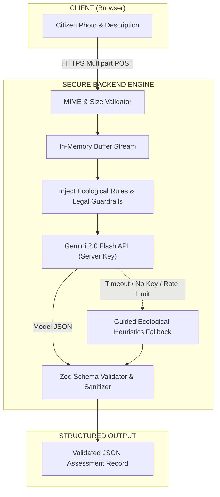

# ARAVALLI SENTINEL — AI Methodology & Scientific Architecture

## 1. Vision & Core Philosophy

The integration of Artificial Intelligence in **ARAVALLI SENTINEL** is strictly guided by the principle of **Human-in-the-Loop Decision Support**:

> **Legal Non-Defamation Axiom:**  
> A photographic image or satellite reflectance anomaly alone cannot establish judicial guilt or prove an offence under the Indian Penal Code or Forest Conservation Act 1980. The AI engine acts as an objective, preliminary indicator extractor, not an automated judicial magistrate.

The AI system serves to:
1. Extract objective visual evidence (e.g. excavated rock benches, heavy machinery tracks, leachate ponds, felled native Dhau tree trunks).
2. Explicitly report technical ambiguities, seasonal limitations (e.g. deciduous leaf shedding during dry months), and optical angle occlusions.
3. Generate a human-in-the-loop **Ranger Field Verification Protocol** (e.g., *Verify Khasra cadastral map*, *Perform total-station boundary survey*).

---

## 2. Google Gemini 2.0 Flash Multimodal Vision Integration

### Architecture & Security Isolation
- The Gemini API integration lives **strictly on the backend server** in [`backend/src/services/geminiService.js`](file:///c:/Users/dlakh/Desktop/ARAVALLI%20SENTINEL/backend/src/services/geminiService.js).
- Client applications **never receive, possess, or bundle** the `GEMINI_API_KEY`.
- Images are accepted via in-memory Multer streams (max 10MB) and validated for MIME types (`image/jpeg`, `image/png`, `image/webp`, `image/heic`).



---

## 3. Structured JSON Schema Specification

Gemini is prompted using strict JSON Schema enforcement. The server validates every response against the following structure:

```json
{
  "detectedThreat": "string",
  "observedVisualIndicators": [
    "string"
  ],
  "confidenceEstimate": "High | Medium | Low",
  "preliminaryRiskScoreImpact": "number (0-100)",
  "explanation": "string",
  "uncertaintyAndLimitations": "string",
  "recommendedVerificationSteps": [
    "string"
  ],
  "isSimulated": "boolean"
}
```

### Prompt Guardrails
1. **Never declare illegal mining as confirmed:** Phrase detections as *"Landform features consistent with mechanical excavation"* or *"Observed open pit with apparent industrial waste accumulation"*.
2. **Mandatory Uncertainty Disclosure:** Every inference must highlight environmental factors (shadows, dry grass, cloud cover, sensor resolution) that prevent 100% certainty from photography alone.
3. **Actionable Checklist:** Provide concrete ground-truthing tasks that can be performed by a Forest Range Officer or Patwari.

---

## 4. High-Fidelity Heuristic Fallback Engine

To guarantee hackathon evaluation resilience without requiring external credentials:
- If `GEMINI_API_KEY` is not detected in `.env`, or if the upstream API returns an error or rate-limit status, the engine automatically routes to the **Guided Ecological Heuristics Engine**.
- The fallback analyzes threat category keywords, image metadata, and regional biogeographical parameters to generate structured observations with `isSimulated: true`.
- Zero broken user interfaces, zero unhandled errors, and 100% operational continuity.

---

## 5. The Explainable 5-Factor Risk Engine

The platform calculates environmental risk through a **deterministic, transparent index** (0 to 100) instead of a black-box deep neural network:

$$\text{Overall Risk} = (M \times 0.30) + (V \times 0.25) + (W \times 0.20) + (C \times 0.15) + (H \times 0.10)$$

### Verified Weights in Source Code:
- **Mining Risk ($M$):** $30\%$ (`0.30`) — Proximity to quarry cuts, heavy dumpers, and blasting events.
- **Vegetation Loss ($V$):** $25\%$ (`0.25`) — Sentinel-2 NDVI canopy decline and Dhau forest clearing.
- **Water Stress ($W$):** $20\%$ (`0.20`) — Groundwater drawdown, nallah blockages, and check-dam desiccation.
- **Citizen Evidence ($C$):** $15\%$ (`0.15`) — Density and corroboration of citizen sighting reports within 30 days.
- **Historical Change ($H$):** $10\%$ (`0.10`) — Decadal land-cover degradation trend.

### Severity Priority Bands:
- **$0 \le \text{Score} \le 30$:** `SAFE` (Ecological baseline)
- **$31 \le \text{Score} \le 50$:** `WATCH` (Early warning, drone patrol recommended)
- **$51 \le \text{Score} \le 75$:** `HIGH RISK` (Elevated threat, joint taskforce inspection notice)
- **$76 \le \text{Score} \le 100$:** `CRITICAL` (Imminent destruction, immediate raid under Supreme Court ban)

### Proportional Normalization for Missing Telemetry:
When an input signal is missing (e.g. cloud cover obscuring optical NDVI):
$$\Omega = \sum_{k \in \text{available}} W_k, \quad W'_k = \frac{W_k}{\Omega}$$
The engine recalculates the score across available weights, sets `transparency.isComplete = false`, and attaches an explicit audit disclaimer.
