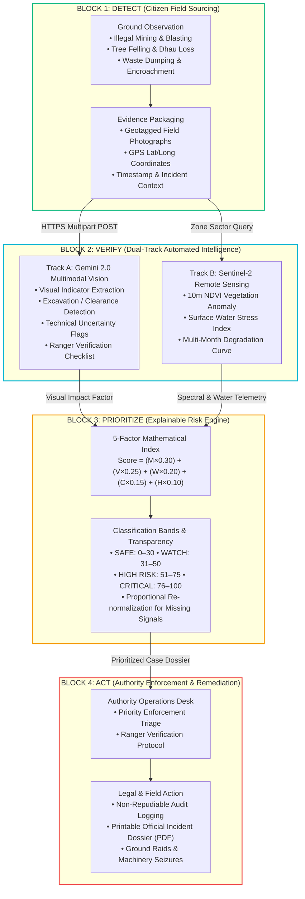
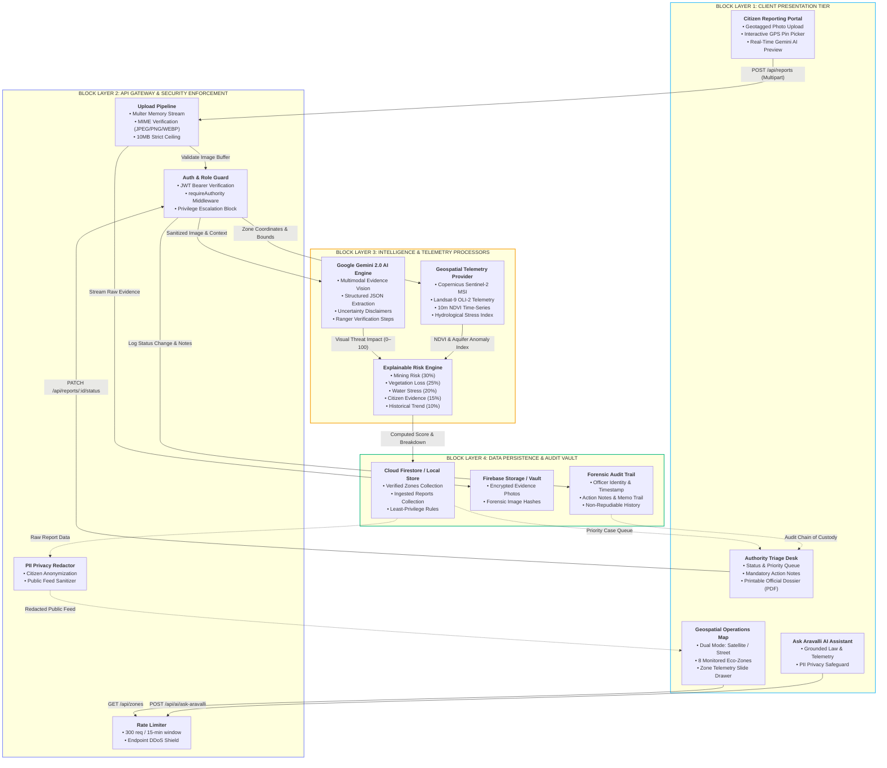

# ARAVALLI SENTINEL — System Architecture & Design Specification

> **Tagline:** See the Threat. Predict the Risk. Protect the Aravallis.  
> **Operational Workflow:** DETECT → VERIFY → PRIORITIZE → ACT  


> **Biogeographical Scope:** The Aravalli Mountain Range spanning Gujarat, Rajasthan, Haryana, and Delhi NCR.

---

## 1. Architectural Philosophy

The Aravalli Range is one of the oldest geological mountain formations on Earth and serves as northwest India's primary ecological shield against the eastern expansion of the Thar Desert. It functions as the critical groundwater recharge aquifer for Delhi NCR and surrounding states, and acts as an unbroken wildlife corridor between Sariska, Asola Bhatti, and Kumbhalgarh.

### The Core Challenges:
1. **Illegal Mining & Quarrying:** Mechanical stone excavation and unpermitted deep pit blasting.
2. **Deforestation:** Systematic felling of native climax *Anogeissus pendula* (Dhau) woodlands.
3. **Leachate & Waste Dumping:** Unregulated toxic dumping into abandoned mining pits.
4. **Encroachment:** Urban real estate speculation across notified Punjab Land Preservation Act (PLPA) lands.

### Engineering Response:
ARAVALLI SENTINEL bridges grassroots citizen observations with satellite remote sensing and Google Gemini AI to equip Forest Departments and Mining Task Forces with actionable, defensible intelligence without premature legal determinations.

---

## 2. High-Level System Architecture (Block Flowchart)



<details>
<summary>View ASCII Text Topology</summary>

```
┌────────────────────────────────────────────────────────────────────────┐
│                        CLIENT PRESENTATION LAYER                       │
│  React 18 + Vite + Tailwind CSS + Lucide Icons + Leaflet / Google Maps │
├────────────────────────────────────────────────────────────────────────┤
│  • Public Ecological Landing Page                                      │
│  • Geospatial Risk Operations Map (Topographic / Satellite)            │
│  • Citizen Threat Reporting Portal (Photo Upload & GPS Pin Picker)     │
│  • Authority Enforcement Triage Desk (Role-Gated Case Management)      │
│  • Grounded "Ask Aravalli" AI Ecological Law Assistant                 │
│  • Printable Official Incident Dossier Generator                       │
└──────────────────────────────────┬─────────────────────────────────────┘
                                   │ HTTPS / REST API
┌──────────────────────────────────▼─────────────────────────────────────┐
│                       BACKEND API & SECURITY LAYER                     │
│               Node.js 24 + Express (ES Modules) + Helmet + Zod         │
├────────────────────────────────────────────────────────────────────────┤
│  • Auth & Role Guard Middleware (Prevents Citizen Privilege Escalation)│
│  • Multer Memory Upload Pipeline (Max 10MB, Strict Image MIME Checks)  │
│  • Rate Limiter (300 requests / 15 min window)                         │
│  • Public Citizen Privacy Redactor (Redacts Phone/Email/Identity)      │
└───────────────────┬─────────────────────────────────┬──────────────────┘
                    │                                 │
     ┌──────────────▼──────────────┐   ┌──────────────▼─────────────┐
     │       AI INTELLIGENCE       │   │    GEOSPATIAL & TELEMETRY  │
     │      Google Gemini API      │   │ Copernicus Sentinel-2 / EE │
     ├─────────────────────────────┤   ├────────────────────────────┤
     │ • Multimodal Evidence Vision│   │ • 10m Multispectral Bands  │
     │ • Visual Indicator Extractor│   │ • Mean NDVI Anomaly Time-  │
     │ • Limitations & Uncertainty │   │   Series                   │
     │ • Ranger Verification Steps │   │ • Surface Water Indices    │
     │ • Strict Non-Defamation     │   │ • Eco-Sensitive Boundaries │
     └──────────────┬──────────────┘   └──────────────┬─────────────┘
                    │                                 │
                    └────────────────┬────────────────┘
                                     │
┌────────────────────────────────────▼───────────────────────────────────┐
│                 THE EXPLAINABLE ARAVALLI RISK ENGINE                   │
├────────────────────────────────────────────────────────────────────────┤
│  Formula:                                                              │
│  Risk = (Mining * 0.30) + (VegLoss * 0.25) + (Water * 0.20) +          │
│         (Citizen * 0.15) + (History * 0.10)                            │
│                                                                        │
│  Classification Bands:                                                 │
│  • SAFE: 0–30 | WATCH: 31–50 | HIGH RISK: 51–75 | CRITICAL: 76–100     │
│  • Proportional Re-normalization with Missing-Factor Transparency      │
└────────────────────────────────────┬───────────────────────────────────┘
                                     │
┌────────────────────────────────────▼───────────────────────────────────┐
│                     DATA PERSISTENCE & AUDIT STORE                     │
├────────────────────────────────────────────────────────────────────────┤
│  • Primary: Firebase Cloud Firestore & Firebase Storage Bucket         │
│  • Fallback: High-Fidelity Local In-Memory Development Store           │
│  • Chain of Custody: Non-repudiable audit logs with officer IDs        │
└────────────────────────────────────────────────────────────────────────┘
```
</details>

---

## 3. The Explainable Risk Engine Mathematical Specification

The platform rejects opaque machine learning scoring in favor of an **explainable, deterministic, multi-factor ecological index** that can be presented in court or at regulatory hearings.

$$\text{Risk Score} = \sum_{i=1}^{5} (F_i \times W_i)$$

| Factor ($F_i$) | Weight ($W_i$) | Ecological & Remote Sensing Basis |
| :--- | :---: | :--- |
| **Illegal Mining Risk** | **30%** | Proximity to unpermitted quarry cuts, blasting acoustic events, and heavy 10-wheeler dumper haul trails. |
| **Vegetation & Canopy Loss** | **25%** | Copernicus Sentinel-2 NDVI degradation index, canopy fragmentation, and native Dhau tree felling. |
| **Aquifer & Water Stress** | **20%** | Groundwater table drawdown, check-dam breach, and seasonal nallah blockage from quarry overburden. |
| **Citizen Ground Evidence** | **15%** | Density, frequency, and corroborated proximity of citizen alerts logged within the past 30 days. |
| **Historical Land Cover Trend**| **10%** | Decadal transition rate from protected deemed forest to degraded rocky scrub. |

### Handling Missing Telemetry Transparently:
If one or more vectors are unavailable (e.g. cloud cover obscuring optical NDVI), the engine does not fabricate values. It calculates:

$$\text{Available Weight Sum } \Omega = \sum_{k \in \text{available}} W_k$$
$$\text{Adjusted Factor Weight } W'_k = \frac{W_k}{\Omega}$$

The calculation output explicitly sets `transparency.isComplete = false`, lists every missing factor, and includes a prominent notice:
`"Score recalculated across 80% available weight. Missing: waterStress."`

---

## 4. Google Gemini Multimodal Vision Integration

Evidence analysis runs on the backend server (`POST /api/reports` and `/api/ai/analyze-evidence`) to guarantee that client applications never possess or expose Gemini API keys.

### Strict Legal & Scientific Constraints:
1. **Assessment, Not Conviction:** Output is marked as an *AI Ecological Assessment* and explicitly disclaims being a judicial finding of guilt.
2. **Technical Limitations Disclosed:** Optical ambiguity, lack of elevation models, and seasonal dry deciduous leaf shedding are clearly reported.
3. **Actionable Ranger Protocol:** Generates a human-in-the-loop field verification checklist (e.g., *Check Khasra revenue map for PLPA Section 4 status*, *Total-station boundary survey*).

---

## 5. Security & Role Architecture

- **Least Privilege:** Public users cannot register as authorities or pass an authority role token.
- **Server Verification:** Authority status is checked on the server using verified institutional credentials or `AUTHORITY_INVITE_SECRET`.
- **Citizen Anonymity:** Citizen names, phone numbers, and IP addresses are completely redacted from public APIs.
- **Audit Immutability:** Case status updates require mandatory action notes, officer timestamps, and cannot be deleted from the audit trail.
