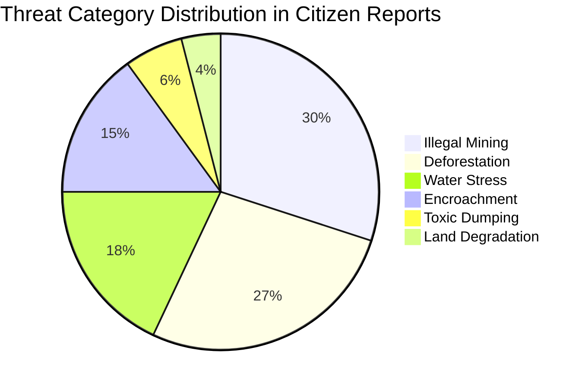

# ARAVALLI SENTINEL — Comprehensive Dataset Guide

## 1. Executive Summary
This guide provides judges, developers, and data scientists with complete architectural insight into the **Aravalli Sentinel Dataset Package** located in [`datasets/`](file:///c:/Users/dlakh/Desktop/ARAVALLI%20SENTINEL/datasets/).

The dataset is partitioned into three complementary layers:
1. **Grassroots Citizen Vigilance Layer** (`datasets/citizen_reports/`): Geotagged threat incidents with image evidence, timestamps, AI confidence, and verification statuses.
2. **Multispectral Satellite Telemetry Layer** (`datasets/environmental_observations/`): Normalized remote sensing indices (NDVI, water stress, land disturbance) modeled after Copernicus Sentinel-2 MSI and USGS Landsat-9.
3. **Geospatial Administrative Vector Layer** (`datasets/risk_zones/`): GeoJSON polygon boundaries defining critical ecological sectors across the Aravalli range.

---

## 2. Directory Layout & Record Counts

| Filepath | Records | Format | Primary Purpose |
| :--- | :---: | :---: | :--- |
| `datasets/citizen_reports/sample_citizen_reports.csv` | 33 | CSV | Demonstrates citizen field sourcing, threat categorization, and initial triage. |
| `datasets/citizen_reports/images/*.jpg` | 33 | JPEG | Valid demonstration photographic evidence files. |
| `datasets/environmental_observations/sample_environmental_observations.csv`| 52 | CSV | 100m grid cell multispectral environmental observations. |
| `datasets/risk_zones/sample_risk_zones.geojson` | 10 | GeoJSON | Polygons of monitored ecological buffer zones. |
| `datasets/image_metadata/sample_image_metadata.csv` | 8 | CSV | Cryptographic SHA-256 hashes, source URLs, and open licenses. |
| `datasets/data_dictionary.md` | — | Markdown | Complete field-level schema definitions. |
| `datasets/sources_and_licenses.md` | — | Markdown | Provenance, ethical disclaimers, and data source citations. |
| `datasets/validation_report.md` | — | Markdown | Automated audit report produced by validation suite. |

---

## 3. Threat Distribution Analysis



---

## 4. Geographic Extent & Sampling Method

The sampling points cover the four key states traversed by the 690-kilometer Aravalli belt:
- **Haryana (Gurugram, Faridabad, Nuh, Bhiwani):** Focus on Bandhwari leachate pits, Tosham granite blasting, and PLPA Section 4/5 deemed forest encroachment.
- **Rajasthan (Alwar, Jaipur, Sikar, Jhunjhunu, Rajsamand, Sirohi):** Focus on Sariska Tiger Reserve buffer quarrying, Nahargarh Dhau clearing, Khetri copper tailings, and Kumbhalgarh stream blockage.
- **Delhi NCR (South Delhi Ridge, Asola Bhatti):** Focus on urban forest fragmentation and illegal boundary walls.
- **Gujarat (Sabarkantha, Banaskantha):** Focus on Idar granite quarrying and Ambaji marble slurry dumping.

All coordinates fall within the validated bounding box:
$$\text{Latitude: } 24.18^\circ \text{N} \le \phi \le 28.88^\circ \text{N}$$
$$\text{Longitude: } 72.84^\circ \text{E} \le \lambda \le 77.34^\circ \text{E}$$

---

## 5. Automated Dataset Validation

The project provides a dedicated validation script [`scripts/validate_dataset.js`](file:///c:/Users/dlakh/Desktop/ARAVALLI%20SENTINEL/scripts/validate_dataset.js) that can be run at any time:

```bash
npm run validate:dataset
```

The validation suite enforces:
- Strict CSV and GeoJSON syntactic correctness
- Range checks: Latitude $[-90, 90]$, Longitude $[-180, 180]$, Risk Score $[0, 100]$, NDVI $[-1.0, 1.0]$
- Physical disk existence of every referenced image
- Uniqueness of `report_id`, `observation_id`, and `zone_id`
- Strict compliance with `is_synthetic` provenance tagging

---

## 6. How to Ingest Real Data

1. **For Field Rangers / DFO Offices:**
   Use the `/report` endpoint or upload via CSV batch script into the backend API (`POST /api/reports`).
2. **For Satellite Remote Sensing:**
   Configure `GEOSPATIAL_PROVIDER=gee` in `backend/.env` with active Google Cloud Earth Engine credentials to stream live Sentinel-2 MSI level-2A surface reflectance data.
