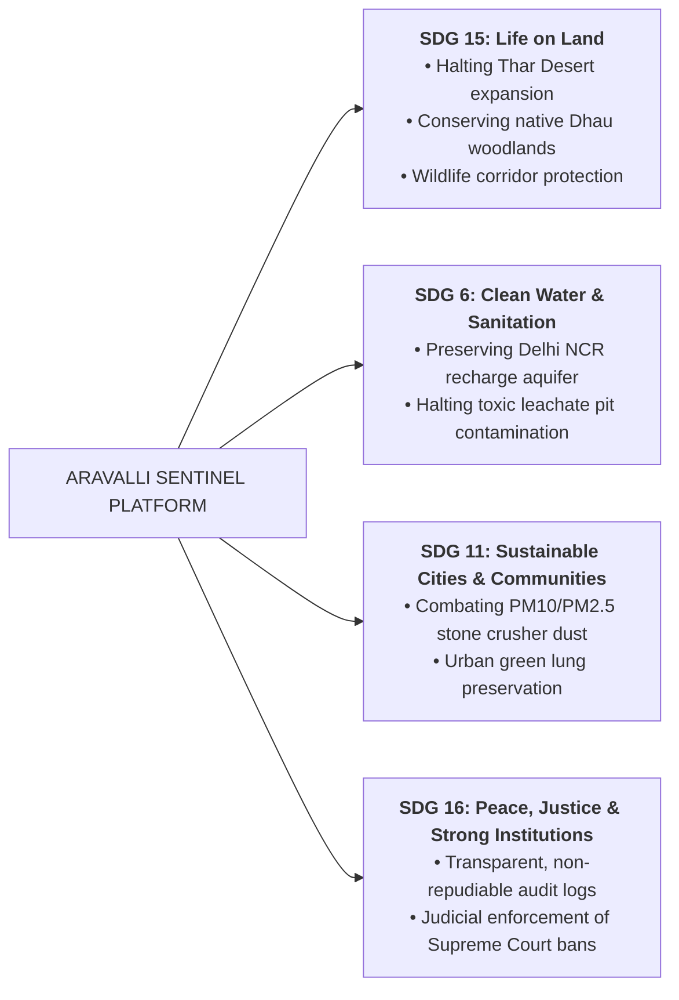

# ARAVALLI SENTINEL — Hackathon 2-Minute Demo Script & Impact Brief

## 1. 2-Minute Hackathon Demo Script

### [0:00 - 0:25] The Problem & Hook
> *"Judges, the Aravalli Mountain Range is 690 kilometers of northwest India's most critical ecological shield. It prevents the eastern march of the Thar Desert into Delhi NCR and recharges drinking water for 40 million people.*  
> *Yet, despite Supreme Court bans, illegal mechanized mining, tree felling, and toxic dumping happen in the dark.*  
> *Complaints languish in bureaucratic queues, and forest rangers lack real-time evidence.*  
> *Enter **ARAVALLI SENTINEL: See the Threat. Predict the Risk. Protect the Aravallis.***"

### [0:25 - 0:55] Workflow 1: Citizen Field Reporting & Gemini AI (DETECT → VERIFY)
> *(Open `/report` on screen)*  
> *"A resident in Gurugram spots illegal night-time quarry blasting near Bandhwari. They snap a photo, drop an exact GPS pin, and hit Submit.*  
> *(Click Analyze Evidence Preview)*  
> *Instantly, our backend runs **Google Gemini 2.0 Flash Multimodal AI**. It extracts visual indicators—rock fracture terraces, heavy machinery tracks, and leachate runoff—without hallucinating legal guilt.*  
> *It explicitly surfaces optical caveats and generates a concrete field verification checklist for rangers."*

### [0:55 - 1:25] Workflow 2: Explainable Risk Engine & Interactive Map (PRIORITIZE)
> *(Navigate to `/map` on screen)*  
> *"Our platform doesn't rely on black-box predictions. The **Explainable Aravalli Risk Engine** computes a deterministic 0-to-100 score across 5 normalized vectors:*  
> *Mining (30%), Canopy Loss (25%), Aquifer Stress (20%), Citizen Evidence (15%), and Historical Trends (10%).*  
> *(Click a zone marker, e.g. Bandhwari, to reveal the slide-out drawer)*  
> *The system clearly visualizes NDVI vegetation anomalies, contributing drivers, and flags missing signals with mathematical transparency."*

### [1:25 - 1:50] Workflow 3: Authority Triage & Action (ACT)
> *(Navigate to `/authority` on screen)*  
> *"Now we switch to the Forest Officer Console. Protected by cryptographic role gates, the officer sees prioritized case queues.*  
> *They review the AI findings, update the case status to 'VERIFIED', record mandatory audit notes, and click **Print Official Incident Dossier**.*  
> *(Show printable dossier modal with QR code, hash headers, and officer signature blocks)*  
> *This dossier serves as admissible administrative documentation for immediate police raids and FIR registration."*

### [1:50 - 2:00] Conclusion & Call to Action
> *"Aravalli Sentinel delivers zero-credential fallback resilience, complete machine-readable datasets, and defensible environmental intelligence.*  
> *Together, we can safeguard India's oldest mountain range for generations to come. Thank you!"*

---

## 2. Environmental Impact & UN Sustainable Development Goals (SDGs)

Aravalli Sentinel directly addresses 4 core United Nations Sustainable Development Goals:

### Measurable Ecological Metrics
1. **Response Time Compression:** Reduces administrative triage latency from weeks to under 48 hours through automated risk scoring.
2. **Aquifer Protection:** Alerts prevent dumping into deep fracture zones that feed Gurgaon and South Delhi borewells.
3. **Forensic Traceability:** Non-repudiable officer timestamps prevent file suppression and ensure accountability.
